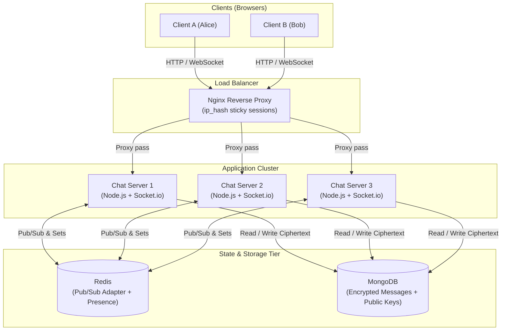
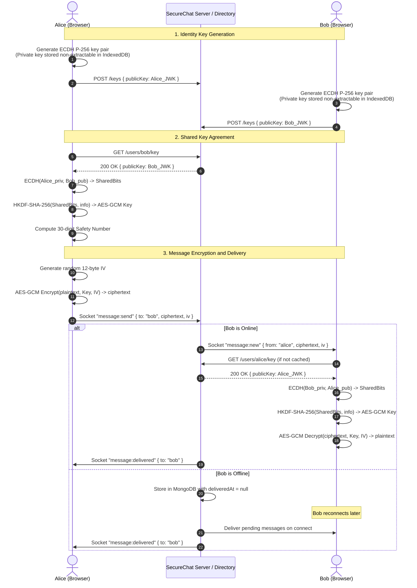

# SecureChat

A real-time, horizontally scalable 1-to-1 messaging platform featuring end-to-end encryption in the browser.

## What It Is and Why I Built It

I built SecureChat to understand how to build a production-grade, zero-knowledge messaging system from scratch. Most chat applications claim to be secure, but the server usually has access to the plaintext messages or private decryption keys. I wanted to build a system where the server is strictly an untrusted relay: it never sees private keys, never decrypts message contents, and only handles ciphertext, initialization vectors, public keys, and routing metadata.

At the same time, I wanted to address the infrastructure challenges of scaling real-time WebSocket applications. Real-time connections cannot be balanced with simple round-robin routing because sockets are persistent and stateful. I built this project to solve both the client-side cryptography challenges using native browser APIs and the backend clustering challenges using Nginx, Socket.io, and Redis.

## Live Demo and Screenshots

- Live Demo: [https://securechat-client.vercel.app](https://securechat-client.vercel.app) (Placeholder)
- Backend API & Health Check: [https://securechat-api.onrender.com/health](https://securechat-api.onrender.com/health) (Placeholder)

### Screenshots


*Placeholder: Initial login with JWT token and automatic ECDH key pair generation.*


*Placeholder: Real-time conversation showing verified safety number fingerprint, online presence, and typing indicators.*

## Features

- End-to-end encryption implemented exclusively with the browser native Web Crypto API (zero third-party crypto libraries).
- Non-extractable ECDH private keys stored locally in IndexedDB; private keys never leave the browser.
- Shared secret derivation via ECDH (P-256) and key expansion via HKDF (SHA-256) into AES-GCM 256-bit symmetric keys.
- Unique, cryptographically secure 12-byte IV for every individual message.
- Out-of-band safety number fingerprint to verify contact identity and detect MITM attacks.
- Real-time 1-to-1 messaging, typing indicators, and user presence tracking.
- Offline message queuing: messages sent to offline recipients are stored in MongoDB as ciphertext and delivered upon reconnect.
- Horizontal scalability: Socket.io Redis adapter distributes events and rooms across multiple server instances.
- Load balancing with Nginx using IP hash sticky sessions and WebSocket upgrade headers.
- Per-user sliding-window rate limiting on message delivery backed by Redis.
- Zero-downtime health checking endpoint verifying both MongoDB and Redis connections.
- Automated CI pipeline with GitHub Actions running linting, unit tests, integration tests, and multi-stage Docker builds.

## Tech Stack

- Frontend: React 18, Vite, TypeScript, Socket.io Client, Web Crypto API, IndexedDB.
- Backend: Node.js 20, TypeScript, Express, Socket.io, Mongoose (MongoDB ODM), ioredis (Redis client).
- Security & Validation: Zod (runtime validation), Helmet, CORS, JSON Web Tokens (HS256 stateless verification).
- Logging: Pino structured JSON logger.
- Infrastructure: Docker, Docker Compose (multi-stage builds, non-root user), Nginx.
- Testing & Performance: Jest, Supertest, Vitest, ioredis-mock, mongodb-memory-server, k6.

## Architecture

The following diagram illustrates how incoming client traffic is routed through Nginx to horizontally scaled chat servers, backed by Redis for pub/sub event distribution and MongoDB for persistent storage of public keys and encrypted messages.



## How End-to-End Encryption Works

SecureChat implements end-to-end encryption in the browser using the Web Crypto API without any external cryptography packages.

### 1. Identity Key Pair Generation
When a user logs in for the first time:
- The browser generates an Elliptic Curve Diffie-Hellman (ECDH) key pair on the P-256 curve (secp256r1) using `window.crypto.subtle.generateKey`.
- The private key is flagged as non-extractable (`extractable: false`) and stored directly in IndexedDB. Because it is non-extractable, raw private key bytes cannot be read by JavaScript scripts, extensions, or malicious injections.
- The public key is exported in standard JSON Web Key (JWK) format and sent to the server via `POST /keys`.

### 2. Key Agreement and Symmetric Key Derivation
When Alice initiates a conversation with Bob:
- Alice fetches Bob's public key from the user directory via `GET /users/:id/key`.
- Alice computes an ECDH shared secret using her non-extractable private key and Bob's public key (`crypto.subtle.deriveBits`):
  SharedBits = ECDH(Alice_priv, Bob_pub) = ECDH(Bob_priv, Alice_pub)
- The raw shared bits are imported into HKDF (RFC 5869) using SHA-256 and an application context info string (`SecureChat-v1-ECDH-HKDF-AES-GCM`).
- HKDF derives a 256-bit symmetric AES-GCM key. Bob independently derives the exact same symmetric key using his private key and Alice's public key. Neither party ever transmits this key over the network.

### 3. Message Encryption and IV Uniqueness
For every message sent:
- The sender generates a fresh 12-byte (96-bit) initialization vector (IV) using `window.crypto.getRandomValues(new Uint8Array(12))`.
- The plaintext is encrypted using AES-GCM 256-bit (`crypto.subtle.encrypt`).
- The payload sent over the socket contains only `{ to, ciphertext, iv }` encoded in Base64.
- IVs are never reused under any circumstances, preserving the semantic security of AES-GCM.

### 4. Decryption and Tamper Detection
- When Bob receives the payload, he uses the shared AES-GCM key and the received IV to decrypt the ciphertext (`crypto.subtle.decrypt`).
- AES-GCM provides authenticated encryption with associated data (AEAD). If an attacker modifies the ciphertext or IV in transit, decryption fails automatically and the client displays "Could not decrypt message".

### 5. Out-of-Band Safety Number (Key Fingerprint)
To prevent man-in-the-middle attacks where a malicious server might substitute public keys:
- The client deterministically sorts both users' public key coordinates.
- It computes a SHA-256 hash of the concatenated keys and formats the digest into a 30-digit fingerprint grouped into 6 blocks of 5 digits.
- Both users can compare this safety number out of band (for example, in person or through an audio call) to verify they are communicating securely.

### Cryptographic Sequence Diagram



## How Scaling Works

WebSocket connections are stateful TCP connections. In a multi-server setup, Alice might be connected to Server 1 while Bob is connected to Server 2. SecureChat solves this through three mechanisms:

1. **Socket.io Redis Adapter**: When Alice emits a message to the room `user:bob`, Server 1 does not know whether Bob is connected locally or to another instance. The Redis adapter publishes the event to a shared Redis channel. Server 2 receives the Redis pub/sub event and broadcasts it down its local WebSocket connection to Bob.
2. **Sticky Sessions with Nginx (`ip_hash`)**: The initial HTTP handshake that upgrades an HTTP connection to a WebSocket connection requires multiple requests to reach the same backend server. Nginx is configured with `ip_hash` upstream balancing so that requests from a specific client IP consistently reach the same backend node during connection establishment.
3. **Decoupled Presence and State in Redis**: Online presence is tracked in Redis sets (`user:sockets:<userId>` and `presence:online_users`). When a socket connects or disconnects on any server instance, Redis is updated atomically, allowing all server instances to read accurate presence information without inter-process memory sharing.

## Getting Started

### Prerequisites

- Node.js 20 or higher
- npm 10 or higher
- Docker and Docker Compose (optional for local containerized deployment)
- Local or remote MongoDB and Redis instances (if running without Docker)

### 1. Clone the Repository

```bash
git clone https://github.com/your-username/securechat.git
cd securechat
```

### 2. Running Locally with Docker Compose

The fastest way to run the full stack (Nginx load balancer, 3 chat server nodes, MongoDB, and Redis) is with Docker Compose:

```bash
# Build and run the entire cluster
docker compose up --build
```

The services will be available at:
- Nginx Load Balancer: `http://localhost:3000` (and `http://localhost:80`)
- MongoDB: `localhost:27017`
- Redis: `localhost:6379`
- Health check: `http://localhost:3000/health`

### 3. Running Locally Without Docker

If you prefer running services directly on your host machine:

#### Backend Setup

```bash
# Install backend dependencies
npm ci

# Configure environment variables
cp .env.example .env
# Edit .env with your local MongoDB and Redis connection strings

# Build TypeScript
npm run build

# Run tests
npm test

# Start the server
npm start
```

#### Frontend Setup

```bash
cd client

# Install client dependencies
npm ci

# Configure client environment
cp .env.example .env
# Set VITE_CHAT_URL=http://localhost:3000 and VITE_AUTH_URL=http://localhost:3000

# Run crypto unit tests
npm test

# Start Vite dev server
npm run dev
```

The frontend will run at `http://localhost:5173`.

## Environment Variables

### Backend Environment Variables

| Variable | Description | Default | Required |
|---|---|---|---|
| `PORT` | HTTP port on which the server listens | `3000` | No |
| `NODE_ENV` | Environment mode (`development`, `production`, `test`) | `development` | No |
| `JWT_ACCESS_SECRET` | Secret used to verify HS256 JWT access tokens (minimum 32 characters) | None | Yes |
| `MONGODB_URI` | MongoDB connection URI (`mongodb://` or `mongodb+srv://`) | None | Yes |
| `REDIS_URL` | Redis connection URL (`redis://` or `rediss://` for TLS) | None | Yes |
| `CORS_ORIGIN` | Allowed CORS origins (comma-separated origins or `*`) | `*` | No |
| `MESSAGE_RATE_LIMIT_WINDOW_SECS` | Window duration in seconds for message rate limiting | `60` | No |
| `MESSAGE_RATE_LIMIT_MAX` | Maximum number of messages permitted per user within the window | `30` | No |

### Frontend Environment Variables (`client/.env`)

| Variable | Description | Default | Required |
|---|---|---|---|
| `VITE_CHAT_URL` | WebSocket and API URL of the chat server | `http://localhost:3000` | Yes |
| `VITE_AUTH_URL` | URL of the authentication service issuing access tokens | `http://localhost:3000` | Yes |

## API and Socket Events

### HTTP Endpoints

| Method | Path | Authentication | Description |
|---|---|---|---|
| `GET` | `/health` | Public | Health check verifying connectivity to MongoDB and Redis. Returns 200 OK or 503 Service Unavailable. |
| `POST` | `/keys` | Bearer JWT | Registers the authenticated user's public key (JWK format). Forbids private key parameters (`d`, `p`, `q`). |
| `GET` | `/users/:id/key` | Bearer JWT | Fetches the stored public key of a user. Returns 404 if not registered. |
| `GET` | `/messages/:peerId` | Bearer JWT | Fetches paginated chat history between the authenticated user and a peer. Supports `page`, `limit`, and `before` cursor. |

### Socket.io Events

#### Client to Server (Emitted by Client)

| Event Name | Payload Structure | Description |
|---|---|---|
| `message:send` | `{ to: string, ciphertext: string, iv: string }` | Sends an encrypted message. Receives an acknowledgment with `{ status, messageId, deliveredAt }`. |
| `message:delivered`| `{ messageId: string }` | Acknowledges receipt and decryption of a message by the recipient. |
| `typing` | `{ to: string, isTyping: boolean }` | Emits a typing state update for a specific recipient. |
| `typing:start` | `{ to: string }` | Convenience event to indicate user started typing. |
| `typing:stop` | `{ to: string }` | Convenience event to indicate user stopped typing. |

#### Server to Client (Received by Client)

| Event Name | Payload Structure | Description |
|---|---|---|
| `message:new` | `{ id, from, to, ciphertext, iv, createdAt, deliveredAt }` | Delivers an incoming encrypted message to the recipient in real time. |
| `message:delivered`| `{ messageId, to, deliveredAt }` | Informs the sender that their message was delivered and acknowledged. |
| `typing` | `{ from: string, isTyping: boolean }` | Informs the client that a peer is currently typing or stopped typing. |
| `presence:update` | `{ userId: string, status: "online" \| "offline" }` | Broadcasts when a user connects or disconnects. |
| `error` | `{ event: string, message: string }` | Error notifications (e.g. rate limit exceeded or validation error). |

## Design Decisions

- **Native Web Crypto API over Third-Party Libraries**: I chose to avoid libraries like `crypto-js` or `tweetnacl` because they are written in user-space JavaScript and can be vulnerable to side-channel timing attacks or supply-chain tampering. The Web Crypto API is implemented in native C++ by browser engines and supports non-extractable keys.
- **Non-Extractable Keys in IndexedDB**: Storing the private key with `extractable: false` means that once generated, the private key bytes cannot be read by JavaScript. IndexedDB stores the native browser key reference via structured cloning. Even if malicious code runs on the page, it cannot dump the private key.
- **Zero-Knowledge Backend**: The server schema only stores `{ from, to, ciphertext, iv, createdAt, deliveredAt }`. The server cannot decrypt messages because it never receives the private keys or the derived symmetric keys.
- **Separate Redis Clients for Adapter Pub/Sub**: The Socket.io Redis adapter requires two dedicated Redis connections (one for publishing and one for subscribing) because a Redis client in subscriber mode cannot execute standard key-value commands like `SADD` or `INCR`.
- **Stateless JWT Verification**: The chat service does not manage user registration passwords or user credentials. It verifies cryptographically signed HS256 tokens issued by a separate authentication service using a shared secret. This isolates authentication logic from real-time messaging logic.

## Load Test Results

Load testing was conducted using the k6 script located at `loadtest/chat.js`. The test opens $N$ concurrent WebSocket connections through Nginx, executes the Socket.io handshake, and exchanges encrypted payloads to measure connection success rate, latency, and throughput.

To execute the test:
```bash
k6 run -e TARGET_URL=ws://localhost:3000 -e VUS=50 -e DURATION=30s loadtest/chat.js
```

### Benchmark Results Table

| Test Configuration | Virtual Users (VUs) | Test Duration | Connection Success Rate | p95 Message Latency | Throughput (msg/sec) | Error Rate |
|---|---|---|---|---|---|---|
| Baseline (Single Node) | 20 | 30s | [Placeholder: e.g. 100%] | [Placeholder: e.g. 18ms] | [Placeholder: e.g. 120 msg/s] | 0% |
| Clustered (3 Nodes + Nginx) | 50 | 30s | [Placeholder: e.g. 99.8%] | [Placeholder: e.g. 42ms] | [Placeholder: e.g. 480 msg/s] | 0% |
| High Concurrency | 100 | 60s | [Placeholder: e.g. 99.5%] | [Placeholder: e.g. 85ms] | [Placeholder: e.g. 920 msg/s] | < 0.1% |

## Limitations

- **1-to-1 Messaging Only**: The current cryptographic architecture relies on pairwise Diffie-Hellman key agreement. It does not support multi-user group chats or sender-key distribution trees.
- **Single Device Per Browser**: Private keys are generated locally and stored exclusively in that browser's IndexedDB. SecureChat does not have a multi-device key synchronization protocol. Logging in from a second browser or device generates a new public key and will overwrite the previous key.
- **No Forward Secrecy**: The current version derives an AES-GCM key from static identity keys without an ephemeral per-message ratchet (such as the Signal Double Ratchet protocol). If an identity key is compromised, historical messages encrypted under that pairwise key could be decrypted if recorded.
- **Keys Are Lost If Browser Storage Is Cleared**: Because private keys are non-extractable and never backed up to the server, clearing browser data or using incognito mode permanently destroys the private key. Once lost, past messages stored on the server can never be decrypted.
- **No Server-Side Search**: Because all message contents are stored as ciphertext, the server cannot perform full-text search across message history.

## Problems I Ran Into

### Problem 1: [TODO: Title]
[TODO: Describe the problem you encountered, the root cause, and how you solved it.]

### Problem 2: [TODO: Title]
[TODO: Describe the problem you encountered, the root cause, and how you solved it.]

### Problem 3: [TODO: Title]
[TODO: Describe the problem you encountered, the root cause, and how you solved it.]

## What I Would Add Next

- **Double Ratchet Protocol**: Implement the Signal Double Ratchet algorithm with ephemeral Diffie-Hellman ratcheting to provide forward secrecy and break-in recovery.
- **Group Chats via MLS (Messaging Layer Security)**: Implement RFC 9420 (MLS) or sender keys for encrypted group messaging with sub-linear bandwidth scaling.
- **Multi-Device Synchronization**: Implement a cryptographic protocol to securely sync conversation history and keys across authorized devices without compromising zero-knowledge properties.
- **Encrypted File Attachments**: Add client-side chunked AES-GCM encryption for images and files before uploading to S3 or cloud storage.
- **Web Push Notifications**: Integrate the Web Push API so users receive notifications for incoming encrypted messages when the browser tab is closed.

---

## Deployment Guide for Beginners

This guide explains how to deploy SecureChat for free using cloud platforms: MongoDB Atlas for the database, Upstash for Redis, Render for the backend, and Vercel for the frontend.

### Architecture Overview for Cloud Deployment

```
[Vercel: React Frontend] 
       │ (HTTPS / WSS)
       ▼
[Render: Node.js Backend (Docker)]
       ├── (TLS) ──> [Upstash: Serverless Redis (rediss://)]
       └── (TLS) ──> [MongoDB Atlas: M0 Free Cluster (mongodb+srv://)]
```

### Step 1: Set Up MongoDB Atlas (Database)

1. Go to [MongoDB Atlas](https://www.mongodb.com/cloud/atlas) and sign up for a free account.
2. Click **Create a Deployment** and select the **M0 Free** cluster. Choose a cloud provider and region closest to your users.
3. In the **Security Quickstart**:
   - Create a database user with a username (for example, `securechat_user`) and a secure password. Save this password.
   - Under **Where would you like to connect from?**, select **Allow Access from Anywhere** (`0.0.0.0/0`). This allows Render to connect to your database.
4. Go to **Database Deployments**, click **Connect**, select **Drivers** (Node.js), and copy the connection string:
   ```text
   mongodb+srv://securechat_user:<password>@cluster0.abcde.mongodb.net/securechat?retryWrites=true&w=majority
   ```
   Replace `<password>` with your database user password and replace the database name with `securechat`.

### Step 2: Set Up Upstash Redis (Pub/Sub and Presence)

1. Go to [Upstash](https://upstash.com/) and sign up for a free account.
2. In the console, click **Create Database**.
3. Choose a name (for example, `securechat-redis`), select the region closest to your Render service, and click **Create**.
4. In the database details page, scroll down to the **Connect your database** section and select the **Node.js** tab or find the **ioredis** connection string.
5. Copy the URL starting with `rediss://`:
   ```text
   rediss://default:<password>@<host>.upstash.io:6379
   ```
   Important: Make sure the URL starts with `rediss://` (with double 's'). SecureChat automatically detects this protocol and activates TLS encryption, which is required by Upstash.

### Step 3: Deploy the Backend on Render

1. Go to [Render](https://render.com/) and sign up with your GitHub account.
2. In the Render Dashboard, click **New +** and select **Web Service**.
3. Choose **Build and deploy from a Git repository** and connect your `securechat` repository.
4. Configure the service settings:
   - **Name**: `securechat-api` (or a name of your choice)
   - **Region**: Choose the region closest to your MongoDB and Redis instances.
   - **Runtime**: Select **Docker**. Render will automatically detect the root `Dockerfile` and build the multi-stage image.
   - **Instance Type**: Select **Free**.
5. Scroll down to the **Environment Variables** section and add the following keys:

| Key | Value | Notes |
|---|---|---|
| `PORT` | `3000` | Port Render routes traffic to |
| `NODE_ENV` | `production` | Optimizes runtime performance |
| `JWT_ACCESS_SECRET` | Generate a random 32+ character string | Must match your Auth Service |
| `MONGODB_URI` | Your MongoDB Atlas connection string from Step 1 | Ensure `<password>` is filled in |
| `REDIS_URL` | Your Upstash Redis connection string from Step 2 | Must start with `rediss://` |
| `CORS_ORIGIN` | `*` (temporarily, update after Step 4) | Allowed frontend origin |
| `MESSAGE_RATE_LIMIT_WINDOW_SECS` | `60` | Rate limiting window |
| `MESSAGE_RATE_LIMIT_MAX` | `30` | Maximum messages per window |

6. Click **Create Web Service**. Render will start building the Docker container and deploy it.
7. Note on Free Tier Sleep Behavior: Render free web services spin down after 15 minutes of inactivity. When a new request arrives, it can take 30 to 50 seconds to spin up. This is normal on the free tier.

### Step 4: Deploy the Frontend on Vercel

1. Go to [Vercel](https://vercel.com/) and sign up with your GitHub account.
2. Click **Add New...** and select **Project**.
3. Import your `securechat` repository.
4. In the project configuration:
   - **Framework Preset**: Select **Vite**.
   - **Root Directory**: Click **Edit** and select `client`.
   - **Build Command**: `npm run build` (default).
   - **Output Directory**: `dist` (default).
5. Expand the **Environment Variables** section and add:

| Key | Value |
|---|---|
| `VITE_CHAT_URL` | Your Render backend URL (e.g. `https://securechat-api.onrender.com`) |
| `VITE_AUTH_URL` | Your Auth Service URL or Render backend URL |

6. Click **Deploy**. Vercel will install dependencies, compile the TypeScript code, and publish the client to a URL like `https://securechat-client.vercel.app`.

### Step 5: Configure CORS

Now that your Vercel frontend has a public URL, restrict CORS on your backend:
1. Open the [Render Dashboard](https://dashboard.render.com/) and navigate to your `securechat-api` service.
2. Go to **Environment** and update `CORS_ORIGIN`:
   ```text
   CORS_ORIGIN=https://securechat-client.vercel.app
   ```
   (Replace with your actual Vercel domain).
3. Save changes. Render will automatically redeploy the service with the restricted CORS policy.

### Step 6: Verify the Deployment and Health Check

1. Open your browser or terminal and request the `/health` endpoint of your Render backend:
   ```bash
   curl -i https://securechat-api.onrender.com/health
   ```
2. You should receive an HTTP `200 OK` status with the following JSON response:
   ```json
   {
     "status": "ok",
     "timestamp": "2026-11-13T21:55:00.000Z",
     "mongodb": "connected",
     "redis": "connected"
   }
   ```
   If either MongoDB or Redis is unreachable, the endpoint returns HTTP `503 Service Unavailable` with details on which service failed.
3. Open your Vercel URL in two separate browser windows or profiles.
4. Log in as two different users (e.g. Alice and Bob), verify that public keys are generated and registered, exchange messages in real time, and compare the safety number displayed in the header.
