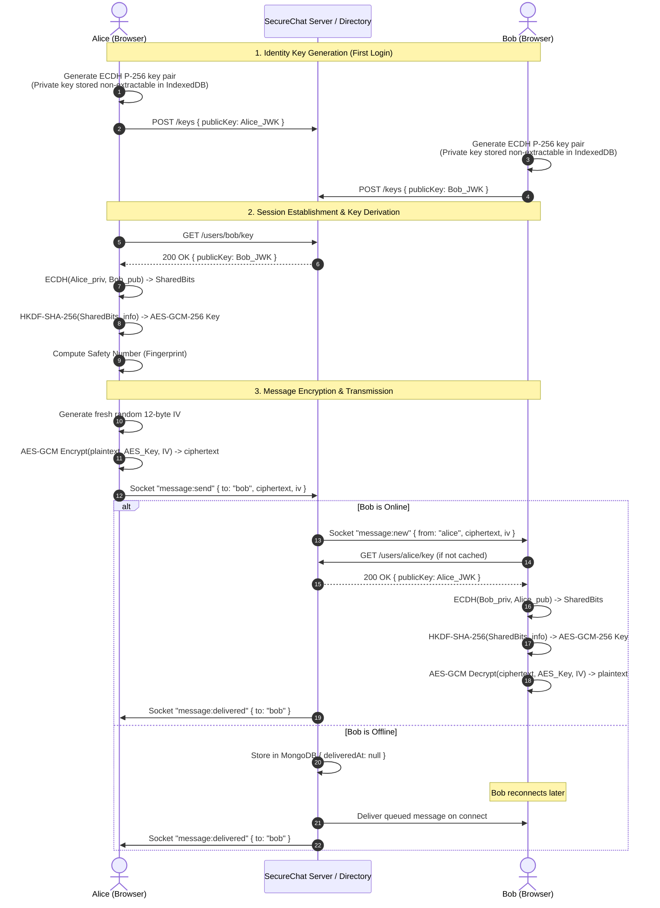

# SecureChat Backend

A secure, real-time 1-to-1 chat backend built with Node.js 20, TypeScript, Express, Socket.io, MongoDB, and Redis.

## Core Features & Architecture

1. **Authentication**
   - Stateless JWT verification with shared secret (`JWT_ACCESS_SECRET`, HS256).
   - Express middleware (`expressAuthMiddleware`) and Socket.io handshake middleware (`socketAuthMiddleware`) rejecting unauthorized requests.
2. **User Directory & E2EE Public Key Exchange**
   - `POST /keys`: Logged-in users register their public key in standard JWK format (`RSA`, `EC`, `OKP`).
   - Server strictly forbids private key parameters (`d`, `p`, `q`, etc.) or symmetric keys (`oct`), guaranteeing the server never sees private keys.
   - `GET /users/:id/key`: Fetches a peer's public key.
3. **End-to-End Encrypted Message Storage**
   - MongoDB Schema: `{ from, to, ciphertext, iv, createdAt, deliveredAt }`.
   - The server treats payload and IV as opaque ciphertext and never decrypts messages.
4. **Real-Time Messaging & Offline Delivery**
   - Socket.io event `message:send` delivers in real-time to online recipients (`message:new`) and confirms delivery back to sender (`message:delivered`).
   - If the recipient is offline, messages are stored in MongoDB with `deliveredAt = null` and automatically dispatched upon reconnect.
   - `GET /messages/:peerId`: Paginated chat history with limit, page, and cursor-based (`before`) filtering.
5. **Presence & Rate Limiting**
   - Online/offline presence tracked in Redis (`presenceService`).
   - Redis-backed sliding/window rate limiting per user on `message:send`.
   - Graceful fail-open: Redis connection errors are logged and never crash the process. Automatic TLS is used when `REDIS_URL` starts with `rediss://`.
6. **Health Check**
   - `GET /health`: Probes connection state for both MongoDB and Redis (returns 200 OK or 503 Degraded).

---

## How the Encryption Works

SecureChat implements zero-knowledge end-to-end encryption in the browser using the **Web Crypto API exclusively** without third-party cryptographic libraries.

### Cryptographic Workflow

1. **Identity Key Generation (First Login)**
   - The browser generates an **ECDH** key pair over the **P-256** (secp256r1) curve via `crypto.subtle.generateKey`.
   - The private key is flagged as **non-extractable** (`extractable: false`) and stored directly in **IndexedDB**. Structured clone allows the browser engine to persist the key handle while ensuring raw private key bytes can never be extracted into JavaScript memory.
   - Only the public key is exported as a standard JWK (containing `kty: "EC"`, `crv: "P-256"`, `x`, `y`) and published to the server via `POST /keys`.

2. **Key Agreement & Symmetric Key Derivation**
   - When Alice chats with Bob, Alice fetches Bob's public key via `GET /users/:id/key`.
   - Alice executes **ECDH key agreement** (`crypto.subtle.deriveBits`) using her non-extractable private key and Bob's public key, producing 256 bits of shared secret material:
     $$S = \text{ECDH}(d_{\text{Alice}}, Q_{\text{Bob}}) = \text{ECDH}(d_{\text{Bob}}, Q_{\text{Alice}})$$
   - The shared bits are imported into **HKDF** (RFC 5869) with **SHA-256**, an empty salt, and a fixed application info context (`SecureChat-v1-ECDH-HKDF-AES-GCM`).
   - HKDF derives a 256-bit symmetric **AES-GCM** key. Both parties arrive at the identical symmetric key independently without transmitting any secret over the wire.

3. **Message Encryption & IV Uniqueness**
   - For every single message, the sender generates a fresh, cryptographically secure 12-byte (96-bit) IV via `crypto.getRandomValues(new Uint8Array(12))`.
   - Plaintext is encrypted using **AES-GCM 256-bit** (`crypto.subtle.encrypt`).
   - The payload sent over Socket.io contains only `{ ciphertext, iv }` encoded in Base64.
   - **IVs are never reused**: each message receives a unique IV, guaranteeing AEAD semantic security and replay protection.

4. **Decryption & Tamper Detection**
   - The receiving client decrypts the ciphertext using the shared AES-GCM key and the received IV (`crypto.subtle.decrypt`).
   - If authentication verification fails (e.g. invalid key, ciphertext modification, or corrupted IV), the client catches the error and displays `"Could not decrypt message"`.

5. **Out-of-Band Safety Number (Key Fingerprint)**
   - A mutual 30-digit safety number is computed by sorting both public keys' coordinates deterministically, hashing the concatenation with SHA-256, and formatting into 6 blocks of 5 digits:
     $$\text{Fingerprint} = \text{SHA-256}(\min(Q_A, Q_B) \mathbin{\Vert} \max(Q_A, Q_B))$$
   - Users can compare this fingerprint out-of-band (e.g. in person or on a phone call) to detect any Man-In-The-Middle (MITM) attacks.

### Protocol Sequence Diagram



---

## Limitations

1. **1-to-1 Only**
   - The current cryptographic design establishes pairwise ECDH shared secrets between pairs of users. Multi-party group chats and sender-keys broadcast encryption are not currently supported.

2. **One Device per Browser**
   - Private keys are generated locally and stored exclusively in that browser's IndexedDB. SecureChat does not implement multi-device key synchronization, so logging in from another device or browser generates a new identity key.

3. **No Forward Secrecy**
   - The AES-GCM session key is derived from static identity ECDH keys without an ephemeral per-message ratchet (such as the Signal Double Ratchet protocol). If an identity private key were compromised, all past and future ciphertexts encrypted under that pairwise key could theoretically be decrypted by an attacker possessing recorded traffic.

4. **Keys are Lost if Browser Storage is Cleared**
   - Because private keys are non-extractable and deliberately never transmitted to any backup server, clearing browser cookies/site data, using private/incognito browsing sessions, or resetting the browser deletes the private key permanently. Historical encrypted messages stored on the server cannot be recovered once the local key handle is lost.

---

## Environment Variables

| Variable | Description | Default |
|---|---|---|
| `PORT` | HTTP port | `3000` |
| `NODE_ENV` | Environment (`development`, `production`, `test`) | `development` |
| `JWT_ACCESS_SECRET` | Shared secret for HS256 JWT verification | *Required* |
| `MONGODB_URI` | MongoDB connection string | *Required* |
| `REDIS_URL` | Redis connection URL (`redis://` or `rediss://`) | *Required* |
| `CORS_ORIGIN` | Allowed CORS origins or `*` | `*` |
| `MESSAGE_RATE_LIMIT_WINDOW_SECS` | Window duration for rate limiting | `60` |
| `MESSAGE_RATE_LIMIT_MAX` | Max messages allowed per window | `30` |

Copy `.env.example` to `.env` for local development:
```bash
cp .env.example .env
```

---

## Development & Testing

### Backend
```bash
# Install dependencies
npm install

# Run backend test suite (passes without any local .env file)
npm test

# Build backend TypeScript to dist/
npm run build

# Start production server
npm start
```

### Frontend Client (React + Vite + TypeScript)
```bash
cd client

# Install client dependencies
npm install

# Run Web Crypto unit tests (Vitest)
npm test

# Build client for production
npm run build

# Start Vite development server
npm run dev
```

---

## Docker Deployment

To launch the backend along with MongoDB and Redis:

```bash
docker compose up --build
```
